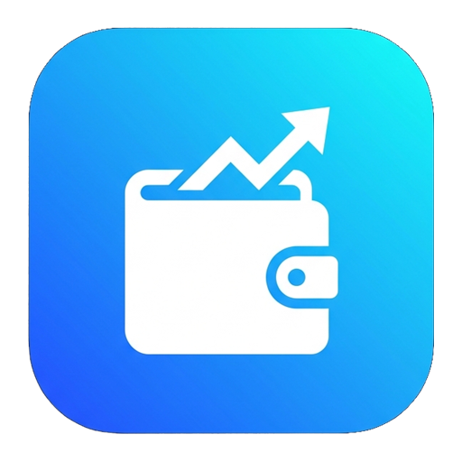

# 💸 SpendSmart — Spese in 1-Tap

<p align="center">
  
</p>

<p align="center">
  <strong>Monitora le spese quotidiane, gestisci il budget e tieni sotto controllo le scadenze mensili in un singolo tocco.</strong>
</p>

<p align="center">
  
  
  
  
</p>

---

## 📖 Panoramica

**SpendSmart** è un'applicazione Android ibrida, lightweight e moderna progettata per semplificare radicalmente la gestione finanziaria personale. A differenza delle complesse app bancarie tradizionali, SpendSmart elimina ogni frizione: non richiede registrazione, non invia dati all'esterno ed è ottimizzata per consentire l'inserimento e il controllo delle spese in **1-tap**.

Combina la fluidità di una UI moderna in **Glassmorphism** (sviluppata con tecnologie web standard) con l'affidabilità di un wrapper nativo **Android (Kotlin)** edge-to-edge.

---

## ✨ Funzionalità Principali

- ⚡ **1-Tap Action:** Segna una spesa come *Pagata* o *Da Pagare* con un solo tocco sul display.
- 📅 **Navigazione Mensile Dinamica:** Scorri facilmente tra mesi passati, presenti e futuri con ricalcolo immediato dei totali.
- 📊 **Dashboard Finanziaria & Progress Bar:** 
  - **Totale Mese:** Somma complessiva delle uscite preventivate.
  - **Pagate:** Ammontare già saldato.
  - **Da Pagare:** Importo rimanente da saldare.
  - **Barra di avanzamento interattiva:** Percentuale grafica di completamento del mese.
- 🔁 **Spese Fisse e Ricorrenti Avanzate:**
  - Configura spese continuative (es. *Affitto*, *Netflix*, *Palestra*).
  - Modalità **Periodo** (*Da Mese* a *A Mese* o senza data di scadenza).
  - Modalità **Mesi Specifici** (per spese bimestrali, trimestrali o annuali come bollette e assicurazioni).
- 🔍 **Filtri Intelligenti:**
  - `Tutte`: Panoramica completa del mese.
  - `Da Pagare`: Focus sulle uscite ancora da saldare.
  - `⚠️ Scadute`: Rilevamento immediato dei pagamenti oltre il giorno prefissato.
  - `Pagate`: Archivio delle spese già regolate.
- ↩️ **Undo / Annulla Istantaneo:** Notifica toast con pulsante *"Annulla"* per ripristinare qualsiasi eliminazione involontaria.
- ✏️ **Modifica e Personalizzazione:** Modale intuitiva per correggere importi, giorni di scadenza o parametri di ricorrenza.
- 🔒 **100% Privacy & Offline-First:** Tutti i dati risiedono esclusivamente nel dispositivo (`LocalStorage`). Nessun tracking, nessuna pubblicità, nessun server remoto.

---

## 🎨 Design & Esperienza Utente

- **Tema Scuro Moderno:** Palette cromatica curata su toni ardesia/blu profondo (`#0f172a`) con accenti verde smeraldo e indaco.
- **Effetto Glassmorphism:** Schede semitrasparenti con sfocatura dinamica dello sfondo (*backdrop-filter*).
- **Sfondo Dinamico:** Gradient blobs animati per dare profondità e modernità all'interfaccia.
- **Tipografia:** Google Font *Inter* per la massima leggibilità.
- **Edge-to-Edge Nativo:** Perfetta integrazione con la barra di stato e la barra di navigazione di Android (`WindowCompat`).

---

## 🛠️ Architettura e Stack Tecnologico

### Frontend (Web Core)
- **HTML5:** Struttura semantica, accessibility e navigazione touch.
- **CSS3:** Custom Properties (variabili CSS), layout responsive Flexbox/Grid, animazioni e glassmorphism.
- **JavaScript (Vanilla ES6+):** Logica di calcolo dei bilanci, gestione dello stato, persistenza dati e gestione eventi senza framework pesanti.

### Applicazione Android
- **Linguaggio:** Kotlin
- **Architettura:** Single-Activity (`MainActivity.kt`) con `Android WebView` ad alte prestazioni.
- **UI System:** AndroidX Core, `WindowCompat` per supporto immersivo a schermo intero.
- **Build System:** Gradle (Kotlin DSL - `build.gradle.kts`) con Version Catalog (`gradle/libs.versions.toml`).
- **Asset Branding:** Icone adattive mipmap generate su tutte le densità (mdpi, hdpi, xhdpi, xxhdpi, xxxhdpi).

---

## 📂 Struttura del Progetto

```text
SpendSmart/
├── app/
│   ├── src/
│   │   ├── main/
│   │   │   ├── assets/              # Interfaccia Web Core
│   │   │   │   ├── index.html       # Markup applicazione
│   │   │   │   ├── styles.css       # Design System & Glassmorphism
│   │   │   │   ├── script.js        # Logica di business & LocalStorage
│   │   │   │   └── logo.png         # Logo ufficiale
│   │   │   ├── java/                # Codice sorgente nativo Kotlin
│   │   │   │   └── com/example/spendsmart/MainActivity.kt
│   │   │   └── res/                 # Icone vettoriali e mipmap adattive
│   │   └── AndroidManifest.xml
│   └── build.gradle.kts
├── gradle/
│   └── libs.versions.toml           # Gestione dipendenze centralizzata
├── build.gradle.kts
├── settings.gradle.kts
└── README.md
```

---

## 🚀 Come Eseguire il Progetto

### 1. Test Rapido nel Browser (Nessuna installazione richiesta)
Puoi testare l'interfaccia immediatamente aprendo il file web:
1. Clona il repository:
   ```bash
   git clone https://github.com/davide23567/spendsmart.git
   ```
2. Apri `app/src/main/assets/index.html` con qualsiasi browser (Chrome, Edge, Firefox, Safari).

### 2. Esecuzione su Dispositivo o Emulatore Android
1. Apri **Android Studio**.
2. Seleziona **Open** e scegli la cartella principale del progetto `SpendSmart`.
3. Attendi il completamento della sincronizzazione di Gradle.
4. Collega uno smartphone Android (con debug USB abilitato) o avvia un emulatore AVD.
5. Clicca su **Run** (o premi `Shift + F10`).

### 3. Generazione APK da Riga di Comando
```powershell
# Su Windows:
.\gradlew.bat assembleDebug

# L'APK generato sarà disponibile in:
# app/build/outputs/apk/debug/app-debug.apk
```

---

## 👤 Autore

**Davide Raimondi**
- GitHub: [@davide23567](https://github.com/davide23567)
- Repository: [https://github.com/davide23567/spendsmart](https://github.com/davide23567/spendsmart)

---

## 📄 Licenza

Questo progetto è rilasciato sotto licenza [MIT](LICENSE).
